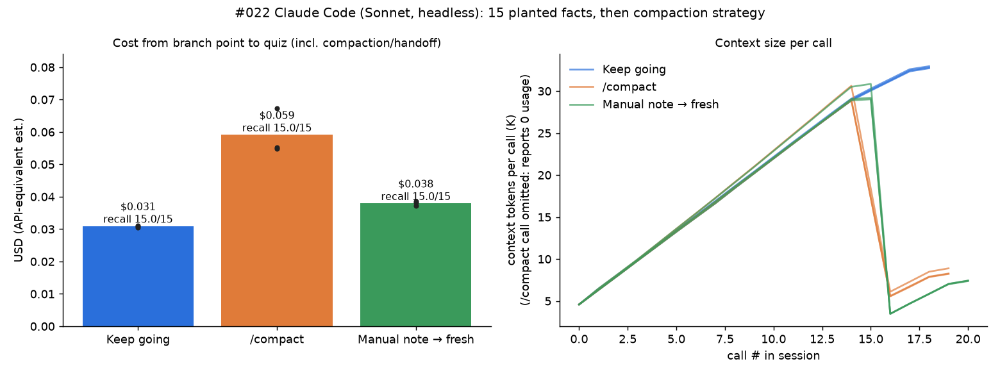

# #022 (Claude arm) Compaction vs manual summaries in a long resumed session

**Engine:** Claude Code CLI 2.1.300, headless (`claude -p ... --output-format json --resume <id>`), `--model sonnet` (reported `claude-sonnet-5-5`), `--tools ""`, `--strict-mcp-config`. All dollar figures are **API-equivalent estimates** from the CLI's `total_cost_usd`, not real billing.

## Question
A long session holds ~15 important facts. Is it cheaper to (a) just keep resuming it, (b) run the built-in `/compact`, or (c) have the model write a handoff note and continue in a fresh session? Do the facts survive?

## Setup
- `scripts/run_022.py ARM REP`: 15 resumed turns. Each turn is about 750 words of random filler ("status log") with one **KEY FACT** planted in it (port numbers, names, bucket IDs, dates, and so on). See `FACTS` in the script. The context grows to about 29K tokens by turn 15.
- **Branch point after turn 15:**
  - `full`: nothing, keep resuming.
  - `compact`: `claude -p "/compact" --resume <id>`. This works headless and keeps the same session id.
  - `manual`: ask the session for a handoff note that keeps every concrete fact verbatim (about 545 output tokens, 1.3K chars), then start a **new** session seeded with that note.
- Then 3 more filler turns with no facts, then a from-memory quiz on all 15 facts, scored by regex (`scripts/analyse_022.py`).
- **n = 3 sessions per arm** (9 sessions, 177 CLI calls). All ran in parallel at about 05:00 IST.

## Important measurement note
In Claude Code, `total_cost_usd` is **cumulative for a resumed session id**: each `--resume` call reports the running total for the session, not that call's cost. The `usage` block, by contrast, is per call. Per-call cost here is therefore the **delta** of `total_cost_usd` within one session id. The `/compact` call reports `usage` all zeros, but it does raise the cumulative cost. That delta is the only way to see what compaction costs.

## Results (means of 3; raw per-session numbers in `results/scores.json`)

| arm | recall (of 15) | branch cost (compact / handoff+seed) | cost of 3 post turns + quiz | **cost after branch point** | whole session | context at quiz |
|---|---|---|---|---|---|---|
| full (keep going) | **15.0** (15,15,15) | n/a | $0.0309 | **$0.031** | $0.165 | 32.8K |
| `/compact` | **15.0** (15,15,15) | $0.0271 | $0.0320 | **$0.059** | $0.204 | 8.5K |
| manual note → fresh | **15.0** (15,15,15) | $0.0151 | $0.0228 | **$0.038** | $0.183 | 7.4K |

Steady-state cost per extra turn (mean of post2/post3): full $0.0080, `/compact` $0.0064, manual $0.0057.
Rough break-even after the branch point, if turns keep looking like these: **manual pays off after ~7 turns** and **`/compact` after ~20 turns**. This is a back-of-envelope linear extrapolation that I did not measure.

## Files
- `results/raw/session_<arm>_r<rep>.json`: every call's full CLI JSON plus extracted tokens and cost
- `results/log_*.txt`: run logs; `results/scores.json`, `results/summary.json`: analysis output
- `scripts/run_022.py`: runner; `scripts/analyse_022.py`: scoring, cost deltas and chart

## Caveats
- **Small and short.** n=3 per arm and only 4 calls after the branch point. The cost ranking is a statement about *short* tails. Longer tails would favour compaction or a handoff.
- **Recall was at ceiling.** Facts were labelled `KEY FACT:` in obviously random filler, and the context was only about 30K tokens, so this is an easy recall test. It cannot separate the arms on quality. Unlabelled facts buried in realistic text would be a harder test.
- Prompt caching (1-hour cache writes) makes "keep going" cheap. Re-reading 30K cached tokens is about $0.008 per turn. Compaction and a fresh session both pay to write a new cache.
- `/compact` cost about 1.8× the manual handoff here. Part of that is its own summarisation call (0 tokens reported, about $0.027 by delta). Its first post-compact turn also re-writes about 3.8K tokens of cache.
- The plant phase differs slightly by arm ($0.134 vs $0.145) because of reply-length noise. It is not part of the comparison.
- The model, effort and system prompt are Claude Code defaults for Sonnet. Results may differ for Opus or for real tool-using sessions.
